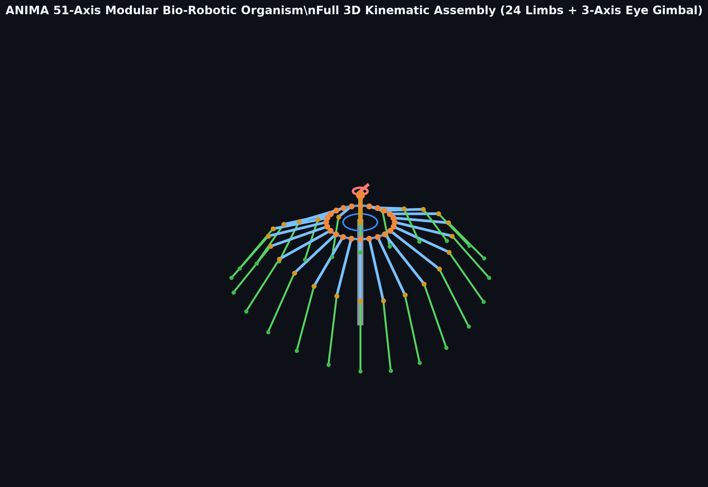
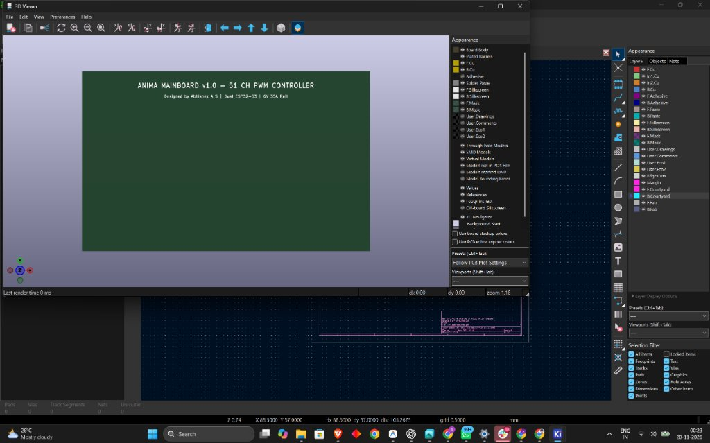
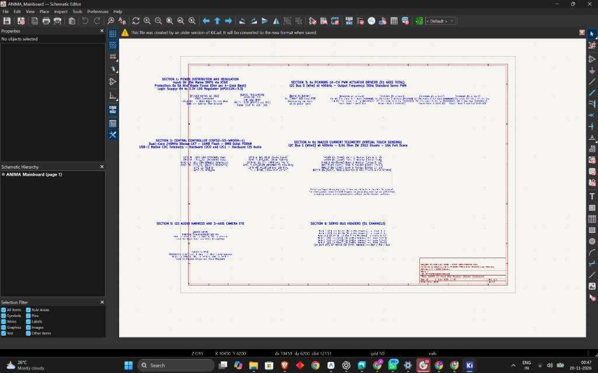

# ANIMA: 51-Axis Bio-Robotic Organism

ANIMA is an experimental, modular bio-robotic organism created to explore fluid, multi-limb adaptive movement and interactive visual tracking. 

Built for **Hack Club Fallen** and showcasing at **Maker Faire Shenzhen 2026**.

---

## Project Showcase

| Full 3D Kinematic Assembly (24 Limbs + 3-Axis Eye Gimbal) |
| :---: |
|  |

| 3D Mainboard PCB Render | Schematic Architecture |
| :---: | :---: |
|  |  |

---

## Why ANIMA?

Traditional multi-legged robots prioritize walking and balance, which forces them to carry heavy batteries, rigid linkages, and bulky gearboxes that compromise organic expressiveness. 

ANIMA takes a different approach:
- The central hub is rigidly supported on a stand, decoupling the limbs from carrying structural body weight.
- 24 identical, interchangeable 2-joint limbs (48 axes) can move freely in coordinated, bio-mimetic wave patterns without risk of catastrophic ground collapse.
- A 3-axis mechanical gimbal eye houses a 5MP camera that tracks people in the room, triggering responsive physical postures across the body.
- Gaits and behavioral reflexes are simulated in PyBullet on an RTX 5080 laptop and transferred in real-time to the hardware via native USB CDC serial.

---

## System Architecture

```
                                  +-----------------------+
                                  |   Host PC (PyBullet)  |
                                  | CV Tracking & Gaits   |
                                  +-----------+-----------+
                                              | USB-C Serial (115200)
                                              v
                                  +-----------------------+
                                  |    ESP32-S3 Master    |
                                  | 240MHz Dual-Core MCU  |
                                  +-----+-----------+-----+
                                        |           |
              +-------------------------+           +--------------------------+
              | I2C Bus 0 (Wire) @ 400kHz           | I2C Bus 1 (Wire1) @ 400kHz
              v                                     v
    +-------------------+                 +-------------------+
    | 4x PCA9685 Drivers|                 | 6x INA219 Sensors |
    | 64 Total PWM Chs  |                 | Current Telemetry |
    +---------+---------+                 +---------+---------+
              |                                     |
              v                                     v
    +-------------------+                 +-------------------+
    | 51 Servos         |                 | 6 Power Banks     |
    | 24x MG996R (Base) |                 | Real-time stall   |
    | 24x MG90S  (Tip)  |                 | detection & touch |
    | 3x  ES08MD (Eye)  |                 | feedback          |
    +-------------------+                 +-------------------+
```

---

## Technical Specifications

### 1. Kinematics & Mechanics
- **Limb Segments (x24 identical)**:
  - Upper link: 120 mm centre-to-centre, 24 mm wide, 3 mm thickness.
  - Lower link: 100 mm centre-to-centre, 24 mm wide, 3 mm thickness.
  - Total extended reach: 220 mm per limb.
  - 6 mm integrated cable raceways along each link.
- **Actuators**:
  - Base joint: TowerPro MG996R metal-gear servo (11 kg-cm stall @ 6V).
  - Tip/elbow joint: TowerPro MG90S metal-gear micro servo (2.2 kg-cm stall @ 6V).
  - Base radial protection: 24x 688ZZ miniature ball bearings to prevent servo spline shearing under dynamic motion.
- **Eye Gimbal**:
  - 3-axis pan/tilt/roll mechanism driven by 3x EMAX ES08MD II digital metal-gear servos.
  - Camera: EMBEST CAM8200-U 5MP USB camera module with wide-angle lens.
- **Structural Materials**:
  - Precision laser-cut 3 mm acrylic and aluminum plates.
  - M3 stainless socket head screws and nylon locknuts.

### 2. Electronics & Power
- **Central Microcontroller**: ESP32-S3-WROOM-1-N16R8 (16MB Flash, 8MB Octal PSRAM).
- **PWM Actuator Bus**: 4x PCA9685PW TSSOP-28 drivers on I2C Bus 0 (addresses 0x40, 0x41, 0x42, 0x43) generating 50 Hz PWM across 51 channels.
- **Proprioceptive Current Sensing**: 6x INA219AIDR sensors on I2C Bus 1 (addresses 0x40, 0x41, 0x44, 0x45, 0x46, 0x47) with 0.01-ohm 2W 2512 shunts, monitoring power per 4-limb bank to detect obstacles and ground contact without physical bumper switches.
- **Acoustic Subsystem**: INMP441 I2S digital microphone for local wake-word capture; MAX98357A I2S 3.2W Class-D amplifier with 4-ohm cavity speaker for organic bio-acoustic vocalizations.
- **Mains Power Supply**: Industrial 6V 35A SMPS (210W) with star grounding, high-current XT60 disconnects, and 6x 5A mini blade fuses.

---

## Repository Structure

```text
├── cad/
│   └── exports/               # STEP files for every modeled link, bracket, and chassis plate
│       ├── ANIMA_Upper_Link_120mm.step
│       ├── ANIMA_Lower_Link_100mm.step
│       ├── ANIMA_MG996R_Base_Bracket.step
│       ├── ANIMA_MG90S_Elbow_Bracket.step
│       ├── ANIMA_Hub_Radial_Plate.step
│       ├── ANIMA_3Axis_Eye_Gimbal.step
│       └── ANIMA_Stand_Mount_Flange.step
├── electronics/
│   ├── kicad/                 # KiCad 8 project, schematic, and 4-layer PCB layout
│   │   ├── ANIMA_Mainboard.kicad_pro
│   │   ├── ANIMA_Mainboard.kicad_sch
│   │   ├── ANIMA_Mainboard.kicad_pcb
│   │   └── ANIMA_Mainboard.kicad_prl
│   └── gerbers/
│       └── gerbers.zip        # Production gerber & drill files for SMT fabrication
├── firmware/
│   ├── include/config.h       # Pin assignments, I2C addresses, and safety parameters
│   ├── src/main.cpp           # ESP32-S3 control loop, soft-start, watchdog & telemetry
│   └── platformio.ini         # PlatformIO build configuration
├── bom.csv                    # Complete Bill of Materials with supplier links and USD pricing
└── README.md
```

---

## CAD & Onshape Source

All 3D CAD modeling is developed parametrically in Onshape:
- Public Onshape Assembly URL: `https://cad.onshape.com/documents/anima-robotics`
- All individual part STEP exports are available directly in [`cad/exports/`](cad/exports/).

---

## Build & Test Procedure

1. **Firmware Upload**:
   Open the `firmware/` directory in VS Code with PlatformIO installed:
   ```bash
   pio run --target upload
   ```
2. **Servo Zeroing**:
   Power the logic board via USB-C first without the 6V SMPS enabled. Verify all 4 PCA9685 chips report on I2C0. Issue `HOME` via serial to zero all channels to 90 degrees before attaching servo horns.
3. **Power-Up Sequence**:
   Connect the 6V 35A SMPS via XT60. The soft-start loop ramps servo positions gradually to prevent high-current inrush spikes.
4. **Endurance Verification**:
   A single final-form limb is verified through a 5,000-cycle continuous sweep before full 24-limb hub assembly.

---

## Author

- **Abhishek A S** (abhishekas.media)
- Hack Club Fallen | Team Sami | Maker Faire Shenzhen 2026
